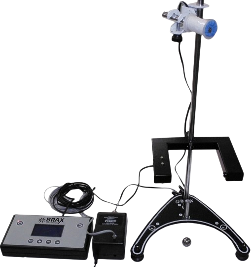

::: {.content-visible when-format="html"}
## Introdução

A queda livre (QL) é um caso particular do Movimento Retilíneo Uniformemente Variado (MRUV), no qual um corpo se desloca verticalmente sob a ação exclusiva da gravidade, com aceleração constante $g$. Desprezando a resistência do ar e o empuxo atmosférico, a aceleração independe da massa do corpo, conforme demonstrado por Galileu Galilei [@Halliday1].

Considerando o corpo abandonado do repouso ($v_0 = 0$), a partir da origem ($h_0 = 0$), e adotando o sentido da queda como positivo, a posição $h$ no instante $t$ é dada por:

$$
h = \dfrac{1}{2} g t^2
$${#eq-posicao}

Analogamente, a velocidade instantânea $v$ varia linearmente com o tempo $t$:

$$
v = g t
$${#eq-velocidade}

Combinando essas equações, obtém-se uma expressão para estimar a velocidade instantânea a partir da altura e do tempo de queda:

$$
  \dfrac{v}{h} = \dfrac{g t }{\dfrac{1}{2} gt^2} \Rightarrow \dfrac{v}{h} = \dfrac{2}{t}
$$

$$
  v = \dfrac{2 h}{t}
$${#eq-velocidade-ht}

Neste experimento, serão medidas a altura de queda ($h$) e o tempo ($t$). Com esses dados, a velocidade será estimada pela @eq-velocidade-ht e, a partir da relação entre velocidade e tempo, será determinada a aceleração da gravidade local ($g$).

## Objetivos


1. Investigar o movimento de queda livre de um corpo sob a ação da força gravitacional.
2. Determinar a velocidade instanânea de um objeto em queda livre a partir de medidas de tempo e altura de queda.
3. Determinar a aceleração da gravidade a partir de dados de tempo e velocidade.

## Material necessário

::: {#fig-aparato-experimental}
{width="350px" max-width="100%"}

<div style="text-align: center;">
  **Fonte:** Labfis (2026)
</div>
:::


- Sistema de sustentação principal de aço;
- Cronômetro digital;
- Sensor fotoelétrico;
- Bobina de retenção magnética;
- Esfera metálica;
- Trena.

## Referências

:::{#refs}
:::
::::


```{=typst}
#show bibliography: it => {
  show heading: none
  it
}

= Introdução

A queda livre (QL) é um caso particular do Movimento Retilíneo Uniformemente Variado (MRUV), no qual um corpo se desloca verticalmente sob a ação exclusiva da gravidade, com aceleração constante $g$. Desprezando a resistência do ar e o empuxo atmosférico, a aceleração independe da massa do corpo, conforme demonstrado por Galileu Galilei @Halliday1.

Considerando o corpo abandonado do repouso ($v_0 = 0$), a partir da origem ($h_0 = 0$), e adotando o sentido da queda como positivo, a posição $h$ no instante $t$ é dada por:

$
h = 1/2 g t^2
$ <eq-posicao>

Analogamente, a velocidade instantânea $v$ varia linearmente com o tempo $t$:

$
v = g t
$ <eq-velocidade>

Combinando essas equações, obtém-se uma expressão para estimar a velocidade instantânea a partir da altura e do tempo de queda:

$
  v/h =   (g t) / (1/2 g t^2)  &arrow.double v/h = 2/t \
  &arrow.double v = (2 h) / t
$<eq-velocidade-ht>

Neste experimento, serão medidas a altura de queda ($h$) e o tempo ($t$). Com esses dados, a velocidade será estimada pela @eq-velocidade-ht e, a partir da relação entre velocidade e tempo, será determinada a aceleração da gravidade local ($g$).

// A queda livre (QL) constitui um dos casos mais fundamentais do Movimento Retilíneo Uniformemente Variado (MRUV). Trata-se de um modelo idealizado no qual um corpo se desloca verticalmente sujeito exclusivamente à atração gravitacional, sob aceleração constante $g$. Do ponto de vista conceitual, esse modelo assume que efeitos dissipativos — como o arrasto do ar e o empuxo atmosférico — são desprezíveis, o que torna a aceleração independente da massa, formato ou densidade do objeto, conforme demonstrado historicamente por Galileu Galilei @Halliday1.

// Tomando a orientação do eixo de movimento no sentido da queda e assumindo que o corpo é abandonado do repouso ($v_0 = 0$) a partir da origem escalar ($h_0 = 0$), a equação horária da posição reduz-se a:

// $
// h = 1/2 g t^2
// $<eq-posicao>

// Analogamente, a magnitude da velocidade instantânea $v$ varia linearmente com o tempo decorrido $t$:

// $
// v = g t
// $<eq-velocidade>


// Em arranjos experimentais, nem sempre é viável medir diretamente a velocidade instantânea $v$. No entanto, combinando a @eq-posicao e a @eq-velocidade, é possível expressar a velocidade instantânea exclusivamente em termos de grandezas escalarmente mais fáceis de mensurar: a altura $h$ e o tempo total de queda $t$. Dividindo a @eq-velocidade pela @eq-posicao, obtém-se:

// $
//   v/h =   (g t) / (1/2 g t^2)  &arrow.double v/h = 2/t \
//   &arrow.double v = (2 h) / t
// $<eq-velocidade-ht>


// Neste experimento, serão coletadas medidas experimentais de posição ($h$) e tempo ($t$). A partir desses dados, a velocidade instantânea $v$ será estimada por meio da @eq-velocidade-ht. Por fim, utilizando a relação funcional entre a velocidade estimada e o tempo (@eq-velocidade), será determinada a aceleração da gravidade local $g$.


= Objetivos

+ Investigar o movimento de queda livre de um corpo sob a ação da força gravitacional.
+ Determinar a velocidade instanânea de um objeto em queda livre a partir de medidas de tempo e altura de queda.
+ Determinar a aceleração da gravidade a partir de dados de tempo e velocidade.

= Material necessário


- Sistema de sustentação principal de aço;
- Cronômetro digital;
- Sensor fotoelétrico;
- Bobina de retenção magnética;
- Esfera metálica;
- Trena.

#figure(
  image("assets/images/aparato-queda-livre.png", width: 60%),
  caption: [Aparato experimental]
)<fig-aparato-experimental>


#pagebreak()

= Procedimentos


#info-box([Funções do cronômetro digital], [
  #set text(size: 9pt)

  #set table(stroke: uft-blue+0.5pt)
  
  #table(
    columns: (3fr, 1fr),
    align: (left+horizon, center+horizon),
    table.header([Para...], [Use]),
    [... ligar/desligar o cronômetro], [#image("/assets/images/liga_desliga.png", width: 30%)],
    [... acessar funções do cronômetro], [#image("/assets/images/acessa_func.png", width: 30%)],
    [... "zerar" o cronômetro], [#image("/assets/images/zera_cronometro.png", width: 30%)],
    [... acionar a retenção magnética], [#image("/assets/images/bobina_magnetica.png", width: 30%)]
  )

  Obs.: O botão de acionamento da bobina de retenção magnética automaticamente zera o cronômetro.
])

+ Com a bobina de retenção magnética fixa, posicione o sensor fotoelétrico a uma distância $h_1$ da bobina, indicada na @tbl-coleta-dados.

+ Configure o cronômetro na função *queda livre*.

+ Zere o cronômetro, acione a bobina e prenda a esfera metálica. Após alguns segundos, a esfera será liberada automaticamente e iniciará a queda livre.

+ Verifique se a esfera atravessou o feixe de luz do sensor. Em caso afirmativo, registre o tempo indicado no cronômetro. Caso contrário, ajuste o alinhamento do sensor e repita a medição.

+ Registre o tempo medido na coluna *Medida 1* da @tbl-coleta-dados.

+ Com o sensor fixo, repita a medição mais quatro vezes e registre os resultados nas colunas *Medida 2* a *Medida 5*.

+ Calcule o tempo médio $t$ das cinco medidas para a posição $h_1$.

+ Utilizando a @eq-velocidade-ht, calcule a velocidade instantânea $v$ correspondente à altura $h_1$ e ao tempo médio $t$.

+ Repita os procedimentos para as demais posições $h_2$ a $h_5$, indicadas na @tbl-coleta-dados.

// + Com a bobina fixa, posicione o sensor fotoelétrico de modo que sua distância até a bobina de retenção magnética seja igual a $h_1$ (ver @tbl-coleta-dados).

// + Ajuste o cronômetro para a função *queda livre*.

// + Zere o cronômetro, acione o sistema de retenção magnética e prenda a esfera metálica à bobina. Após alguns segundos, a esfera será liberada e cairá em queda livre. 

// + Verifique se a esfera passou pelo feixe de luz do sensor fotoelétrico. Se sim, registre o tempo de queda indicado no cronômetro. Caso contrário, ajuste cuidadosamente o alinhamento do sensor em relação à bobina e repita o procedimento.

// + Anote a leitura de tempo na coluna *Medida 1* da @tbl-coleta-dados.

// + Sem alterar a posição do sensor fotoelétrico, repita os passos anteriores mais quatro vezes e colete as medidas 2 a 5 para a posição $h_1$.

// + Calcule o tempo médio $t$ das medidas 1 a 5 para a posição $h_1$.

// + Aplique a @eq-velocidade-ht e calcule a velocidade instantânea para o tempo $t$ e posição $h_1$.

// + Repita os passos anteriores para as demais posições $h_2$ a $h_5$ indicadas na @tbl-coleta-dados.

= Análise de Resultados

+ Construa o gráfico da velocidade $v$ _vs._ tempo $t$ e trace a reta de melhor ajuste.

+ Determine o coeficiente angular, correspondente à aceleração experimental da gravidade ($g_("exp")$).

+ Calcule o desvio percentual associado ao experimento:

$
  Delta g (%) = abs((g_("exp") - g) / g) times 100
$<eq-desvio-percentual>

  #par(first-line-indent: 0pt)[em que $g = 9,8 "m/s"^2$ é o valor teórico esperado para a aceleração da gravidade local.]

+ Discuta os resultados. 

#figure(
  kind: table,
  caption: [Resultados],
)[
  #table(
    columns: (1fr, 1fr, 1fr),
    table.header([$g ("m/s"^2)$], [$g_("exp") ("m/s"^2)$], [$Delta g (%)$]),
    [$9,8$], [], [],
  )
]<tbl-resultados>


#set heading(numbering: none)
= Referências

#bibliography("assets/references/references.bib", style: "assets/references/abnt.csl", title: none)


#place(
  bottom,
  float: true,
  scope: "parent", 
  clearance: 1.5em
)[
  #set table(
    align: center+horizon,
    fill: (x, y) => if y < 2 {
      primary-color.transparentize(60%)
    } else {
      if calc.odd(y) {
        primary-color.transparentize(80%)
      }
    }
  )

  #figure(
    kind: table,
    caption: [Coleta de dados],
  )[
    #table(
      columns: (0.5fr, 0.5fr, 1fr, 1fr, 1fr, 1fr, 1fr, 1fr, 1fr),
      table.header(table.cell(colspan: 2, rowspan: 2)[$h$ (m)], table.cell(colspan: 5)[Medidas de Tempo (s)], table.cell(rowspan: 2)[$t$ médio (s)], table.cell(rowspan: 2)[$v$ (m/s)], [Medida 1], [Medida 2], [Medida 3], [Medida 4], [Medida 5]),
      [$h_1$], [$0,1$], [], [], [], [], [], [], [],
      [$h_2$], [$0,2$], [], [], [], [], [], [], [],
      [$h_3$], [$0,3$], [], [], [], [], [], [], [],
      [$h_4$], [$0,4$], [], [], [], [], [], [], [],
      [$h_5$], [$0,5$], [], [], [], [], [], [], [],
      //table.cell(colspan: 2)[*Média*]
    )
  ]<tbl-coleta-dados>
]
```